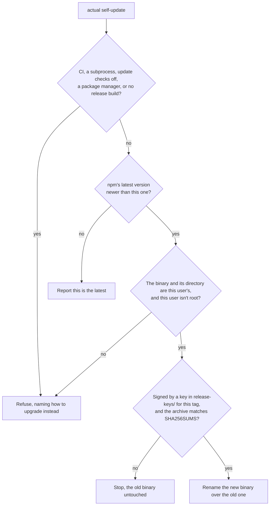

# Self-update

`actual self-update` replaces a copy of `actual` you downloaded by hand with the latest release, once the release's signature checks out. A copy installed with Homebrew, npm or `cargo install` gets that tool's upgrade command instead: each keeps a record of the files it installs, and its next upgrade would overwrite a binary replaced behind its back.

```
$ actual self-update
Downloading actual 0.10.0 (actual-darwin-arm64.tar.gz)…
Updated actual at /Users/me/.local/bin/actual from 0.9.0 to 0.10.0, signed with the primary release key.
```

## How it checks a release

It makes the same checks [Release signing](RELEASE_SIGNING.md#checking-a-download) asks of a person checking a download, in the same order, and nothing on disk changes until both pass:

1. It asks the npm registry for the latest version, the lookup the [daily notice](UPDATE_CHECK.md) makes, so it installs the release the notice announced. When that's the version you have, it says so and stops.
2. It downloads `SHA256SUMS` and `SHA256SUMS.minisig` from that version's page on the [actual-releases](https://github.com/actual-software/actual-releases/releases) mirror and checks the signature against the two public keys in [`release-keys/`](../release-keys), which are built into `actual`. The signed comment's `file:` and `tag:` fields must read `SHA256SUMS` and this release's tag exactly, because an older release's signature still verifies.
3. It downloads the archive for your platform and checks it against the SHA-256 that `SHA256SUMS` lists for it. Only then does it unpack the archive, and what comes out must be a regular file.

A signer adds the signature by hand after the release workflow publishes everything else, so a new release can sit unsigned for a while. `actual self-update` refuses one and asks you to try again later. Releases up to v0.9.0 carry no signature at all.



## How it replaces the binary

The new binary is unpacked into a scratch directory beside the old one, given the old one's permissions, and renamed over it. A rename swaps the file in one step, so a process starting `actual` at that moment runs either the old binary or the new one, never a partial file. That matters because the actual skill's hooks start `actual` many times a session. It also matters on macOS, where writing over a signed binary in place can get its next launch killed.

Two runs at once don't both replace the file. Each holds `~/.actualai/actual/self-update.lock` while it downloads and installs, and a run that had to wait checks whether the other one already replaced the binary, stopping if it did.

A run stopped partway, as by Ctrl-C during the download, leaves its scratch directory behind: a hidden `.actual-self-update-` directory next to the binary. The next run removes any that are more than an hour old, which no live run's can be.

## When it refuses

| Situation | What it prints instead |
|---|---|
| Installed with Homebrew (`/Cellar/actual/` in the binary's path) | `brew upgrade actual-software/actual/actual` |
| Installed with npm (`/node_modules/@actualai/actual-` in the path) | `npm install -g @actualai/actual@latest` |
| Built with `cargo install` (`/.cargo/bin/` in the path) | `cargo install -f --git https://github.com/actual-software/actual-cli actual-cli` |
| A directory you can't write, such as `/usr/local/bin` after the README's `sudo mv` | A suggestion to move `actual` to a directory you own, such as `~/.local/bin` |
| A binary another user owns, such as one copied into place with `sudo cp` | A suggestion to install your own copy in a directory you own |
| Running as root | A suggestion to run it as the user who installed `actual` |
| `CI` is set | A suggestion to install a pinned release in the pipeline |
| `actual` started this process itself (`ACTUAL_CLI_SUBPROCESS=1`) | A suggestion to run it from your own terminal |
| Update checks are off: `ACTUAL_NO_UPDATE_CHECK`, `update_check.enabled: false`, or a config file that fails to load | How to turn them back on |
| No release build for your platform | How to build from source |

A refusal exits with status 2. The ones about who is running it and who owns the binary and its directory come after the version lookup, so they can name the new release; the others make no request at all. A failed download or check exits with status 1 and leaves the old binary as it was. There's no hook mode, and the [daily notice](UPDATE_CHECK.md) that suggests `actual self-update` never shows in the hook modes or under `--json`.
