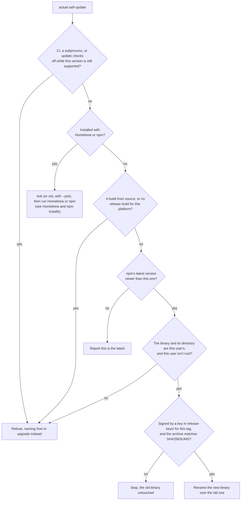

# Self-update

`actual self-update` upgrades `actual` to the latest release, however you installed it:

- **Homebrew or npm**: it runs that tool's upgrade for you, after you confirm. Each keeps a record of the files it installs, so `actual` never replaces them itself. See [Homebrew and npm installs](#homebrew-and-npm-installs).
- **Downloaded by hand**: it replaces the binary with the latest release, once the release's signature checks out.
- **Built from source**, wherever it's installed: it prints the `cargo install` command, because the copy may have been built for a system the release builds don't run on, such as a Linux with a glibc older than 2.39.

For example, updating a hand-downloaded copy from v0.12.0 to a later signed release would look like:

```
$ actual self-update
Downloading actual 0.13.0 (actual-darwin-arm64.tar.gz)…
Updated actual at /Users/me/.local/bin/actual from 0.12.0 to 0.13.0, signed with the primary release key.
```

## Homebrew and npm installs

For a global Homebrew or npm install, `actual self-update` asks the npm registry for the latest version, the same lookup as below. When it's newer, it shows the commands it will run and asks once; Enter alone means no. On Homebrew it runs `brew update` and then `brew upgrade actual-software/actual/actual`, so a tap that hasn't refreshed today still finds the new release. On npm it runs `npm install -g --prefix <prefix> @actualai/actual@latest` for the prefix that holds this copy. Your terminal stays attached, so you see the tool's own output and can answer anything it asks.

```
$ actual self-update
actual 0.17.0 is out (you have 0.16.0). To upgrade, actual self-update runs:
  /opt/homebrew/bin/brew update
  /opt/homebrew/bin/brew upgrade actual-software/actual/actual
Run Homebrew now? [y/N] y
...
Updated actual at /opt/homebrew/bin/actual from 0.16.0 to 0.17.0 with Homebrew.
```

- It runs the `brew` in the Homebrew prefix that holds this copy, so a Mac with Homebrew in both `/usr/local` and `/opt/homebrew` upgrades the right one, and the `npm` on your `PATH`, pointed at this copy's prefix. It runs each as a program, never through a shell, and never with `sudo`.
- npm removes `actual`'s files before it installs the new ones, so close any Claude Code or Codex session that uses `actual` first: a hook that starts `actual` in between finds no binary. It says so before it asks.
- It takes the same lock as a hand-downloaded update, so two runs at once don't both start the package manager. Homebrew's own lock stops a `brew` you started yourself, and that failure shows as `brew`'s.
- Afterwards it asks the upgraded `actual` for its version. When it's still the old one, as when the Homebrew tap doesn't have a release npm already announced, it says so and exits with status 1.
- It acts only on the global install: `<prefix>/bin/actual` must link to this copy, as `brew link` and `npm install -g` leave it. A copy in a project's `node_modules`, npx's cache, or pnpm's or bun's global directory is refused.
- With no terminal to ask in, as in an agent's shell, a hook or a script, it runs nothing and prints the tool's command instead: `brew update && brew upgrade actual-software/actual/actual`, or `npm install -g @actualai/actual@latest`. `actual version --json` reports the same command, for scripts and agents.
- `actual self-update --yes` (`-y`) runs the package manager without asking, also with no terminal. Every refusal below still applies.

## How it checks a release

It makes the same checks [Release signing](RELEASE_SIGNING.md#checking-a-download) asks of a person checking a download, in the same order, and nothing on disk changes until both pass:

1. It asks the npm registry for the latest version, the lookup the [daily notice](UPDATE_CHECK.md) makes, so it installs the release the notice announced. When that's the version you have, it says so and stops.
2. It downloads `SHA256SUMS` and `SHA256SUMS.minisig` from that version's page on the [actual-releases](https://github.com/actual-software/actual-releases/releases) mirror and checks the signature against the two public keys in [`release-keys/`](../release-keys), which are built into `actual`. The signed comment's `file:` and `tag:` fields must read `SHA256SUMS` and this release's tag exactly, because an older release's signature still verifies.
3. It downloads the archive for your platform and checks it against the SHA-256 that `SHA256SUMS` lists for it. Only then does it unpack the archive, and what comes out must be a regular file.

A signer adds the signature by hand after the release workflow publishes everything else, so a new release can sit unsigned for a while. `actual self-update` refuses one and asks you to try again later. The workflow publishes `SHA256SUMS` from v0.12.0; releases through v0.11.0 carry neither that file nor a signature.



## How it replaces the binary

The new binary is unpacked into a scratch directory beside the old one, given the old one's permissions, and renamed over it. A rename swaps the file in one step, so a process starting `actual` at that moment runs either the old binary or the new one, never a partial file. That matters because the actual skill's hooks start `actual` many times a session. It also matters on macOS, where writing over a signed binary in place can get its next launch killed.

Two runs at once don't both replace the file. Each holds `~/.actualai/actual/self-update.lock` while it downloads and installs, and a run that had to wait checks whether the other one already replaced the binary, stopping if it did.

A run stopped partway, as by Ctrl-C during the download, leaves its scratch directory behind: a hidden `.actual-self-update-` directory next to the binary. The next run removes any that are more than an hour old, which no live run's can be.

## When it refuses

| Situation | What it prints instead |
|---|---|
| Installed with Homebrew (`/Cellar/actual/` in the binary's path), stdin or stderr isn't a terminal, and no `--yes` | `brew update && brew upgrade actual-software/actual/actual` |
| Installed with npm (`/node_modules/@actualai/actual-` in the path), stdin or stderr isn't a terminal, and no `--yes` | `npm install -g @actualai/actual@latest` |
| Homebrew or npm, but `<prefix>/bin/actual` doesn't link to this copy, as for a project's own `node_modules` | A suggestion to upgrade it with the tool that put it there |
| npm's prefix belongs to another user, such as `/usr/lib/node_modules` | A suggestion to move npm's prefix to a folder you own (`npm config set prefix ~/.local`, with `~/.local/bin` first on your `PATH`), then the npm command |
| Homebrew's `Cellar/actual` belongs to another user | A suggestion to run it as the user who owns Homebrew |
| Built from source, wherever it's installed: any build the release workflow didn't make, which marks its own with `ACTUAL_RELEASE_BUILD` when it compiles | `cargo install -f --git https://github.com/actual-software/actual-cli actual-cli` |
| A directory you can't write, such as `/usr/local/bin` after the README's `sudo mv` | A suggestion to move `actual` to a directory you own, such as `~/.local/bin` |
| A binary another user owns, such as one copied into place with `sudo cp` | A suggestion to install your own copy in a directory you own |
| Running as root | A suggestion to run it as the user who installed `actual` |
| `CI` is set | A suggestion to install a pinned release in the pipeline |
| `actual` started this process itself (`ACTUAL_CLI_SUBPROCESS=1`) | A suggestion to run it from your own terminal |
| Update checks are off: `ACTUAL_NO_UPDATE_CHECK`, `update_check.enabled: false`, or a config file that fails to load, unless this copy is below the [oldest supported release](UPDATE_CHECK.md#supported-versions) | How to turn them back on |
| No release build for your platform | How to build from source |

A refusal exits with status 2. The ones about who is running it and who owns the binary and its directory come after the version lookup, so they can name the new release; the others make no request at all. A failed download or check exits with status 1 and leaves the old binary as it was. On Homebrew and npm, answering no exits with status 4 and runs nothing, and when `brew` or `npm` fails, `actual self-update` stops there and exits with that tool's status (1 if a signal stopped it), so a status other than 1, 2 and 4 is the package manager's own. There's no hook mode, and the [daily notice](UPDATE_CHECK.md) that suggests `actual self-update` never shows in the hook modes or under `--json`.
