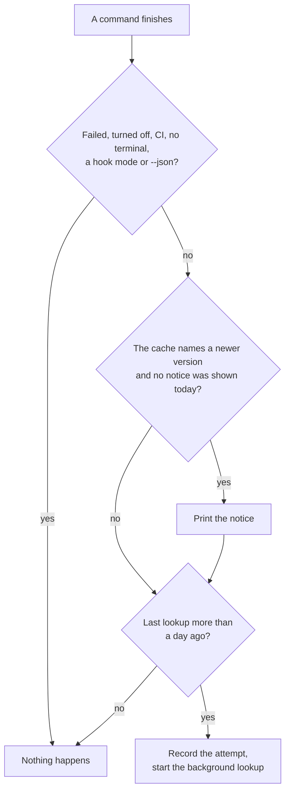

# Update check

Once a day, `actual` tells you when a newer release is out and prints the command that upgrades the copy you're running. The check itself never replaces the binary. Homebrew and npm keep track of the files they install, so for their copies the upgrade stays with them; for a copy you downloaded by hand, the notice names [`actual self-update`](SELF_UPDATE.md).

## The notice

After a command finishes you may see:

```
actual 0.9.0 is available (you have 0.8.0).
To upgrade, run: brew upgrade actual-software/actual/actual
```

The command depends on how the running binary was installed, which `actual` reads from its own path:

| Installed with | The binary's path contains | Upgrade |
|---|---|---|
| Homebrew | `/Cellar/actual/` | `brew upgrade actual-software/actual/actual` |
| npm | `/node_modules/@actualai/actual-` | `npm install -g @actualai/actual@latest` |
| Anything else | | [`actual self-update`](SELF_UPDATE.md) |

The Homebrew command names the tap in full because a bare `brew upgrade actual` reaches Homebrew's unrelated `actual` cask.

## When it runs

No command waits for the check. After a command finishes, `actual` prints the notice from a small cache file, `~/.actualai/actual/update-check.yaml`, at most once a day. When the cache's last lookup is more than a day old, `actual` records the attempt and starts a background copy of itself that asks the npm registry for the latest version and writes the answer to the cache, so the notice reaches you on a later run. Commands that finish at the same moment share one lookup and one notice: each holds a lock on `update-check.lock`, beside the cache, while it reads and updates the cache.



It stays quiet when:

- the command fails: the notice shows only after a successful command;
- stdout or stderr isn't a terminal, as when output goes to a pager such as `less` or into a file, or `CI` is set;
- the command runs in a mode a program reads: any `--json` output, the `--claude-hook` and `--claude-session-start` modes the actual skill's hooks use, and `mint-token`;
- `actual` runs inside a `claude` subprocess it started itself (`ACTUAL_CLI_SUBPROCESS=1`);
- the check is turned off, or the config file fails to load.

A quiet run leaves the cache untouched, so it uses up neither the day's notice nor its lookup. The exception is `actual version --check`, which records the version it finds: that counts as the day's lookup, and the day's notice stays unspent. A lookup that fails or times out is silent, and the next one waits a day.

## Turning it off

Either of these stops every request to the registry, including the one `actual version --check` makes:

```bash
export ACTUAL_NO_UPDATE_CHECK=1                # any non-empty value
actual config set update_check.enabled false
```

A config file that fails to load counts as off as well, because it may be the file turning the check off: one invalid value rejects the whole file, `update_check.enabled: false` included. Until it loads again, nothing reaches the registry and `actual version --check` reports the latest as not checked. `actual config show` names the problem.

## `actual version`

`actual version` prints the running version, how it was installed and how to upgrade it. It makes no network request unless you add `--check`, which asks the npm registry for the latest version (one HTTPS request, at most 3 seconds) and records the answer in the cache.

`--json` prints one object, for scripts and for the actual skill:

```json
{
  "current_version": "0.8.0",
  "latest_version": "0.9.0",
  "update_available": true,
  "channel": "homebrew",
  "upgrade_command": "brew upgrade actual-software/actual/actual",
  "release_url": "https://github.com/actual-software/actual-releases/releases/latest"
}
```

| Field | Value |
|---|---|
| `current_version` | The running version. |
| `latest_version` | The latest published version. `null` without `--check`, with the check turned off or a config file that fails to load, or when the registry didn't answer. |
| `update_available` | Whether `latest_version` is newer than `current_version`. `null` whenever `latest_version` is. |
| `channel` | `homebrew`, `npm` or `other`. |
| `upgrade_command` | The upgrade command for `channel`, or `null` for `other`, whose copies upgrade with [`actual self-update`](SELF_UPDATE.md). |
| `release_url` | The latest release's page, for downloading a release by hand. |

New fields may be added; existing ones keep their names and meanings. A minimum-version check needs only the local facts, so `actual version --json` answers it without a request. A release from before this command existed rejects `version` as an unknown subcommand and exits with status 2.
