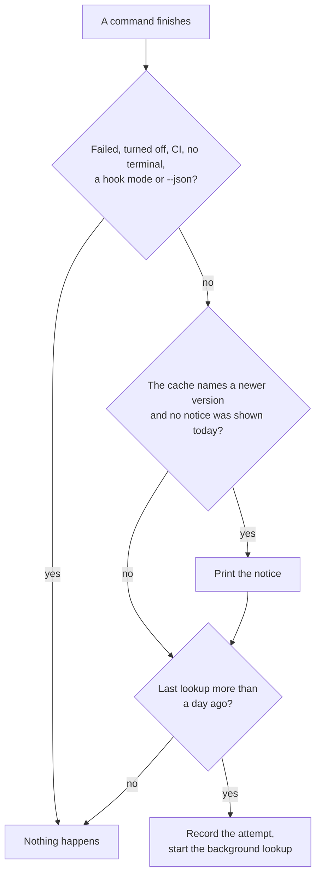

# Update check

Once a day, `actual` tells you when a newer release is out and prints the command that upgrades the copy you're running. The check itself never replaces the binary. For a release installed with Homebrew or npm or downloaded by hand, the notice names [`actual self-update`](SELF_UPDATE.md), which runs Homebrew's or npm's upgrade for their installs; for a copy built from source, it names the `cargo install` command that rebuilds it.

## The notice

After a command finishes you may see:

```
actual 0.9.0 is available (you have 0.8.0).
To upgrade, run: actual self-update
```

The command depends on how the running binary was installed, which `actual` reads from its own path, and for any other copy on whether the release workflow built it. `actual version --json` reports, as `upgrade_command`, a command that works with no one there to answer a question, as in an agent's shell:

| Installed with | The binary's path contains | The notice and `actual version` | `upgrade_command` in `--json` |
|---|---|---|---|
| Homebrew | `/Cellar/actual/` | [`actual self-update`](SELF_UPDATE.md) | `brew update && brew upgrade actual-software/actual/actual` |
| npm | `/node_modules/@actualai/actual-` | [`actual self-update`](SELF_UPDATE.md) | `npm install -g @actualai/actual@latest` |
| Anything else, from a release | | [`actual self-update`](SELF_UPDATE.md) | `actual self-update` |
| Anything else, built from source | | `cargo install -f --git https://github.com/actual-software/actual-cli actual-cli` | `null` |

On Homebrew and npm, `actual self-update` asks before it runs the package manager, so it needs a terminal or `--yes`; without either it prints the package manager's command instead, which is why `--json` names that command. The Homebrew command runs `brew update` first because `brew upgrade` reads a copy of the tap that refreshes at most once a day, and never with `HOMEBREW_NO_AUTO_UPDATE` set, so without it a release from today can look absent. It names the tap in full because a bare `brew upgrade actual` reaches Homebrew's unrelated `actual` cask. A release build is one the release workflow compiled, which marks it with `ACTUAL_RELEASE_BUILD`; every other build counts as built from source, wherever it's installed.

## When it runs

No command waits for the notice's check. After a command finishes, `actual` prints the notice from a small cache file, `~/.actualai/actual/update-check.yaml`, at most once a day. When the cache's last lookup is more than a day old, `actual` records the attempt and starts a background copy of itself that asks the npm registry for the latest version and writes the answer to the cache, so the notice reaches you on a later run. Commands that finish at the same moment share one lookup and one notice: each holds a lock on `update-check.lock`, beside the cache, while it reads and updates the cache.



It stays quiet when:

- the command fails: the notice shows only after a successful command;
- stdout or stderr isn't a terminal, as when output goes to a pager such as `less` or into a file, or `CI` is set;
- the command runs in a mode a program reads: any `--json` output, the `--claude-hook`, `--claude-session-start`, `--codex-hook` and `--codex-session-start` modes the actual skill's hooks use, and `mint-token`;
- `actual` runs inside a `claude` or `codex` subprocess it started itself (`ACTUAL_CLI_SUBPROCESS=1`);
- the check is turned off, or the config file fails to load.

A quiet run leaves the cache untouched, so it uses up neither the day's notice nor its lookup. The exception is `actual version --check`, which records the version it finds: that counts as the day's lookup, and the day's notice stays unspent. A lookup that fails or times out is silent, and the next one waits a day.

## Supported versions

The npm registry's `minimum` dist-tag names the oldest release still supported. When it is newer than the running copy, a release build refuses to run commands, prints this and exits with status 78:

```
actual 0.16.0 is no longer supported (minimum 0.17.0). Run "actual self-update", then try again.
```

`actual` reads the minimum from the same cache as the notice. Before a command, it asks the registry first (one request, at most 1.5 seconds) when the last answer is more than a week old, or when the cached minimum says this copy is too old, so a lowered minimum lets it run again. It asks at most once an hour across all its processes, so a machine that can't reach the registry waits at most once an hour. With no answer and nothing cached, it runs. A copy built from source prints the same message as a warning and runs anyway, and never asks the registry before a command. A `minimum` newer than the same answer's `latest` counts as no minimum, since no release could meet it.

These always run: `actual --version`, `actual version`, `actual help` and `--help`, `actual self-update`, `actual plugin update`, `actual rules report-use`, `actual adr refresh`, and the internal commands. Below the minimum, `actual self-update` runs even with update checks turned off, so the command the message names always works. It still refuses under `CI`; install a newer pinned release there.

Turning update checks off doesn't turn this off: `ACTUAL_NO_UPDATE_CHECK` and `update_check.enabled: false` stop the notice, `actual version --check` and the background lookup, not this one.

### The plugin's version

The Actual plugin's hooks tell `actual` the plugin's version in `ACTUAL_PLUGIN_VERSION`. In a hook mode (`--claude-hook`, `--codex-hook`, `--claude-session-start`, `--codex-session-start`), a plugin older than this CLI supports gets status 78 and:

```
Your Actual plugin 1.13.1 is too old for actual 0.18.0. Run "actual plugin update", then restart Claude Code.
```

Codex gets "then start a new Codex thread." A command you or an agent run directly never needs the variable. A plugin from before this check sets no version, and it shows status 78 only as "governance did not run", so for that plugin the hook answers in a shape it already shows (a denial of the plan in Claude Code, `impl-check`'s notice at the end of a turn) and exits 0, and the other hooks stay silent.

`actual plugin update` updates the plugin with Claude Code's and Codex's own commands, in each one that has it installed, or in the one `--agent claude` or `--agent codex` names. It says when the new version applies: once you restart Claude Code, or in a new Codex thread. It exits 2 when neither has the plugin, and with the agent's own status when its command fails. `--background` starts that in a detached process at most once a day, prints nothing and returns at once; the plugin runs it when a session starts.

## Turning it off

Either of these stops the notice's requests to the registry, including the one `actual version --check` makes (the [supported-version check](#supported-versions) still runs):

```bash
export ACTUAL_NO_UPDATE_CHECK=1                # any non-empty value
actual config set update_check.enabled false
```

A config file that fails to load counts as off as well, because it may be the file turning the check off: one invalid value rejects the whole file, `update_check.enabled: false` included. Until it loads again, the notice makes no request and `actual version --check` reports the latest as not checked; the [supported-version check](#supported-versions) still runs. `actual config show` names the problem.

## `actual version`

`actual version` prints the running version, how it was installed and how to upgrade it. It makes no network request unless you add `--check`, which asks the npm registry for the latest version (one HTTPS request, at most 3 seconds) and records the answer in the cache.

`--json` prints one object, for scripts and for the actual skill:

```json
{
  "current_version": "0.8.0",
  "latest_version": "0.9.0",
  "update_available": true,
  "channel": "homebrew",
  "upgrade_command": "brew update && brew upgrade actual-software/actual/actual",
  "release_url": "https://github.com/actual-software/actual-releases/releases/latest"
}
```

| Field | Value |
|---|---|
| `current_version` | The running version. |
| `latest_version` | The latest published version. `null` without `--check`, with the check turned off or a config file that fails to load, or when the registry didn't answer. |
| `update_available` | Whether `latest_version` is newer than `current_version`. `null` whenever `latest_version` is. |
| `channel` | `homebrew`, `npm` or `other`. |
| `upgrade_command` | A POSIX shell command line that upgrades this copy with no one there to answer a question: the package manager's command for `homebrew` and `npm`, [`actual self-update`](SELF_UPDATE.md) for an `other` copy from a release, and `null` for one built from source, which rebuilds with the `cargo install` command. See the table above. |
| `release_url` | The latest release's page, for downloading a release by hand. |

New fields may be added; existing ones keep their names and meanings. A script that needs a minimum version of `actual` can compare `current_version` itself, without a request. A release from before this command existed rejects `version` as an unknown subcommand and exits with status 2.
